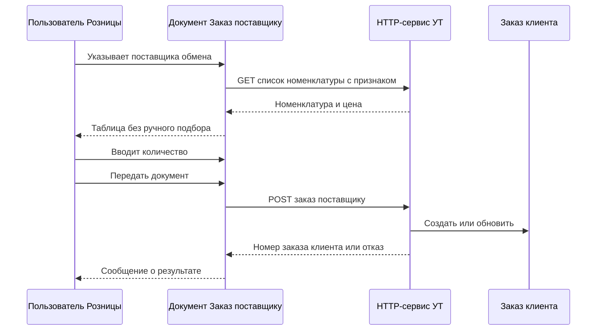

# Техническое задание

## Обмен документа «Заказ поставщику» (1С:Розница) с документом «Заказ клиента» (1С:Управление торговлей)

| Параметр | Значение |
| --- | --- |
| Шифр | БСХП-ОБМ-ЗП-01 |
| Основание | Пример ТЗ «обмен, при котором из Розницы получают перечень товаров, оформляют заказ поставщику и передают его в Управление торговлей» и уточнения к нему |
| Редакция | 2.0 |
| Системы | 1С:Розница 2.3 — инициатор; 1С:Управление торговлей 11.4 / 11.5 — HTTP-сервис и документ «Заказ клиента» |
| Платформа | 1С:Предприятие 8.3.21 или новее, управляемые формы |
| Способ поставки | Расширение конфигурации в каждой базе. Внешняя обработка не разрабатывается и в работе пользователя не участвует |
| Протокол | HTTPS, методы GET и POST, тело и ответ JSON, кодировка UTF-8 |

### История изменений относительно примера ТЗ

1. В Рознице пользователь работает в типовом документе «Заказ поставщику». Отдельной обработки с командами «Заполнить из УТ», «Создать заказ поставщику» и «Передать в УТ» нет.
2. В УТ у номенклатуры появляется реквизит типа «Булево» с наименованием «Используется в Заказе поставщику в Рознице». В список для Розницы попадают только позиции, у которых реквизит равен «Истина».
3. В документе Розницы номенклатура и цена заполняются автоматически. Количество вводит пользователь с отдельной ролью.
4. На форме документа «Заказ поставщику» есть кнопка «Передать документ».
5. Ранее переданный документ можно передать повторно. Повторная передача обновляет уже созданный «Заказ клиента» и второй документ не создает.
6. Если по этому заказу клиента в УТ уже создана «Реализация товаров и услуг», повторная передача не выполняется. Пользователь Розницы получает сообщение с номером заказа клиента и номером реализации. Документы УТ при этом не изменяются.

---

## 1. Цель

Сократить ручной перенос номенклатуры и количеств из магазина в центральную базу.

Магазин в базе Розницы оформляет обычный документ «Заказ поставщику» на центральную организацию. Состав номенклатуры и цены подставляются из УТ по отмеченной номенклатуре. Сотрудник с правом ввода количества указывает количество и нажимает «Передать документ». В УТ появляется заполненный «Заказ клиента». Повторная передача обновляет этот заказ клиента до тех пор, пока по нему не оформлена реализация.

## 2. Термины

| Термин | Смысл в этом ТЗ |
| --- | --- |
| Розница | Информационная база 1С:Розница магазина, инициатор обмена |
| УТ | Информационная база 1С:Управление торговлей |
| Заказ поставщику | `Документ.ЗаказПоставщику` Розницы. Документ, который видит и передает пользователь |
| Заказ клиента | `Документ.ЗаказКлиента` УТ. Создается и обновляется сервисом по заказу поставщику |
| Реализация | `Документ.РеализацияТоваровУслуг` УТ, в строках которой указан этот заказ клиента |
| Признак участия | Реквизит номенклатуры УТ «Используется в Заказе поставщику в Рознице». В обмене участвует позиция со значением «Истина» |
| Режим обмена | Состояние документа «Заказ поставщику», в котором контрагент документа — поставщик из настройки обмена. Только в этом режиме работают автозаполнение, ограничение количества и кнопка «Передать документ» |
| Передача | Успешный POST, после которого заказ клиента в УТ создан или обновлен |
| Повторная передача | Передача документа, по которому заказ клиента в УТ уже есть |

«Реквизит заполнен» для типа «Булево» в этом ТЗ означает значение «Истина». Значение «Ложь» позицию в заказ не включает. Отдельного пустого значения у булева реквизита нет.

## 3. Границы работ

### 3.1. Входит в объем

- Расширение УТ: реквизит номенклатуры, его вывод на форму, HTTP-сервис из двух методов, создание и обновление заказа клиента, проверка реализации, роль служебного пользователя, регистр связи заказов, журнал обмена.
- Расширение Розницы: поведение документа «Заказ поставщику» в режиме обмена, автозаполнение номенклатуры и цены, ввод количества по роли, кнопка «Передать документ», повторная передача, сообщения пользователю, хранение результата передачи, настройки подключения и сопоставления.
- Сопоставление номенклатуры, характеристики, организации магазина с партнером и контрагентом УТ, поставщика Розницы с организацией-продавцом УТ.
- Сценарии приемки из раздела 14.

### 3.2. Не входит в объем

- Внешняя обработка и любой отдельный рабочий стол заказа.
- Оплата, счет, счет-фактура, ордер на отгрузку, ЭДО, фискализация.
- Обмен статусами заказа после передачи, кроме проверки реализации в момент повторной передачи.
- Регламентное обновление остатков и цен помимо ответа GET в момент заполнения или обновления документа.
- Автоматическое создание реализации и автоматическое проведение заказа клиента менеджером не заменяется: проведение после обновления выполняет сотрудник УТ, если сервис снял проведение.
- Заказы поставщику другим контрагентам. Для них документ Розницы работает как типовой.
- Удаление, пометка на удаление и отмена заказа клиента при удалении заказа поставщику в Рознице.
- Подбор номенклатуры пользователем. Состав строк определяет признак в УТ.
- Изменение цены пользователем Розницы. Цена приходит из УТ.
- Несколько заказов клиента на один заказ поставщику и объединение нескольких заказов поставщику в один заказ клиента.

## 4. Роли систем



Розница вызывает УТ. УТ Розницу не вызывает.

Один заказ поставщику соответствует не более чем одному действующему заказу клиента. Ключ связи — уникальный идентификатор ссылки заказа поставщику Розницы. Номер и дата документа в ключ не входят: они могут измениться при перенумерации.

## 5. Объекты поставки

Префикс объектов расширения: `БСХП_`. Типовые объекты остаются на поддержке и изменяются только расширением. Оба расширения назначаются, снимаются и обновляются средствами платформы, без снятия конфигурации с поддержки.

### 5.1. Расширение УТ «БСХП_ОбменЗаказамиРозницы»

| Объект | Назначение |
| --- | --- |
| Реквизит `Справочник.Номенклатура.БСХП_ИспользуетсяВЗаказеПоставщикуВРознице` | Признак участия. Тип «Булево», синоним «Используется в Заказе поставщику в Рознице». Индексируется. Значение новой и существующей номенклатуры — «Ложь» |
| Поле на форме элемента номенклатуры | Флажок в группе «Обмен с Розницей» на основной форме элемента. Для группы справочника поле скрыто |
| HTTP-сервис `БСХП_RetailOrders` | Корневой URL `retail-orders`, шаблон `v1` |
| Регистр сведений `БСХП_ЗаказыРозницы` | Связь идентификатора заказа Розницы с заказом клиента |
| Реквизит `Документ.ЗаказКлиента.БСХП_НомерЗаказаПоставщикуРозницы` | Номер заказа поставщику для формы УТ. Строка 20 |
| Реквизит `Документ.ЗаказКлиента.БСХП_ДатаЗаказаПоставщикуРозницы` | Дата заказа поставщику |
| Реквизит `Документ.ЗаказКлиента.БСХП_ИдентификаторЗаказаПоставщикуРозницы` | Строка 36, индексируется |
| Роль `БСХП_СервисОбменаСРозницей` | Права служебного пользователя HTTP |
| Константа `БСХП_ПараметрыСервисаЗаказовРозницы` | Значения по умолчанию: организация УТ, склад, вид цены. Хранится как хранилище значения структуры либо отдельными константами с теми же именами полей |

Регистр `БСХП_ЗаказыРозницы`:

| Поле | Вид | Тип |
| --- | --- | --- |
| ИдентификаторЗаказаРозницы | измерение | Строка 36 |
| ЗаказКлиента | ресурс | `ДокументСсылка.ЗаказКлиента` |
| НомерЗаказаРозницы | ресурс | Строка 20 |
| ДатаЗаказаРозницы | ресурс | Дата |
| ДатаПоследнегоОбмена | ресурс | Дата и время |

Периодичность регистра — непериодический. Запись независимая.

### 5.2. Расширение Розницы «БСХП_ЗаказПоставщикуВУТ»

Реквизиты шапки `Документ.ЗаказПоставщику`:

| Реквизит | Тип | Кто заполняет |
| --- | --- | --- |
| `БСХП_СостояниеПередачи` | Перечисление `БСХП_СостоянияПередачиЗаказаВУТ` | Сервис обмена |
| `БСХП_ИдентификаторЗаказаКлиентаУТ` | Строка 36 | Сервис обмена |
| `БСХП_НомерЗаказаКлиентаУТ` | Строка 20 | Сервис обмена |
| `БСХП_ДатаЗаказаКлиентаУТ` | Дата | Сервис обмена |
| `БСХП_ДатаПоследнейПередачи` | Дата и время | Сервис обмена |
| `БСХП_ТекстПоследнегоОтвета` | Строка 500 | Сервис обмена |

Значения перечисления: `НеПередавался`, `Передан`, `ОшибкаПередачи`.

Реквизиты табличной части `Товары`:

| Реквизит | Тип | Назначение |
| --- | --- | --- |
| `БСХП_ИдентификаторНоменклатурыУТ` | Строка 36 | Идентификатор, полученный в GET. Уходит в POST |
| `БСХП_ИдентификаторХарактеристикиУТ` | Строка 36 | Пустая строка, если характеристики нет |
| `БСХП_ОстатокУТ` | Число 15.3 | Остаток на складе УТ на момент последнего заполнения. На форме только просмотр. В POST не передается |
| `БСХП_СтрокаЗаполненаИзУТ` | Булево | «Истина» для строк, добавленных обменом |

Команды формы документа:

| Команда | Заголовок | Где расположена |
| --- | --- | --- |
| `БСХП_ПередатьДокумент` | Передать документ | Командная панель формы |
| `БСХП_ОбновитьНоменклатуруИЦены` | Обновить номенклатуру и цены | Командная панель формы, группа «Обмен с УТ» |

Над табличной частью в режиме обмена выводится нередактируемая строка состояния: состояние передачи, номер и дата заказа клиента УТ, дата последней передачи, текст последнего ответа.

Роль `БСХП_РаботаСЗаказомПоставщикуДляУТ`. Роль включается в профиль групп доступа «БСХП: заказ поставщику для УТ».

| Действие | Есть роль | Нет роли |
| --- | --- | --- |
| Создать и открыть «Заказ поставщику» по типовым правам | Да | Да |
| Видеть автоматически заполненные номенклатуру, цену, сумму, остаток УТ | Да | Да |
| Менять количество и количество упаковок в режиме обмена | Да | Нет, поле только просмотр |
| Нажать «Передать документ» | Да | Кнопка скрыта, серверный вызов отклоняется |
| Нажать «Обновить номенклатуру и цены» | Да, если есть право изменения документа | Да, если есть право изменения документа |
| Менять номенклатуру, характеристику, цену, ставку НДС в режиме обмена | Нет | Нет |
| Добавлять строки вручную в режиме обмена | Нет | Нет |

Серверные процедуры передачи и записи количества повторно проверяют роль. Скрытия кнопки на форме недостаточно.

Настройки Розницы:

| Объект | Назначение |
| --- | --- |
| Константа `БСХП_АдресСервисаУТ` | Базовый адрес вида `https://сервер/имя_базы/hs/retail-orders/v1` |
| Константа `БСХП_ПользовательСервисаУТ` | Имя служебного пользователя УТ |
| Безопасное хранилище, ключ `БСХП_ПарольСервисаУТ` | Пароль. На форму и в журнал не выводится. Запись и чтение через методы БСП работы с безопасным хранилищем |
| Константа `БСХП_ТаймаутСервисаУТ` | Число секунд. По умолчанию 60 |
| Регистр сведений `БСХП_НастройкиЗаказаПоставщикуПоМагазинам` | Параметры режима обмена в разрезе магазина |
| Регистр сведений `БСХП_СоответствиеНоменклатурыУТ` | Найденные и ручные соответствия номенклатуры |

Регистр настроек по магазину, одна запись на магазин:

| Поле | Вид | Тип | Смысл |
| --- | --- | --- | --- |
| Магазин | измерение | `СправочникСсылка.Магазины` | Магазин документа |
| КонтрагентПоставщик | ресурс | `СправочникСсылка.Контрагенты` | Контрагент шапки, при котором документ входит в режим обмена. Это центральная организация, поставщик для магазина |
| ИдентификаторОрганизацииУТ | ресурс | Строка 36 | Организация-продавец в заказе клиента |
| ИдентификаторСкладаУТ | ресурс | Строка 36 | Склад отгрузки в заказе клиента и склад остатка в GET |
| ИдентификаторВидаЦеныУТ | ресурс | Строка 36 | Вид цены GET и строк заказа клиента |
| ИдентификаторПартнераУТ | ресурс | Строка 36 | Партнер заказа клиента. Покупатель — организация магазина |
| ИдентификаторКонтрагентаУТ | ресурс | Строка 36 | Контрагент заказа клиента |
| ИдентификаторСоглашенияУТ | ресурс | Строка 36 | Соглашение с клиентом, обязательное для заказа клиента |

Пароль, адрес и пользователь сервиса общие для базы Розницы: база магазина обращается в одну базу УТ.

Регистр соответствия номенклатуры:

| Поле | Вид | Тип |
| --- | --- | --- |
| ИдентификаторНоменклатурыУТ | измерение | Строка 36 |
| ИдентификаторХарактеристикиУТ | измерение | Строка 36 |
| Номенклатура | ресурс | `СправочникСсылка.Номенклатура` |
| Характеристика | ресурс | `СправочникСсылка.ХарактеристикиНоменклатуры` |
| СпособСопоставления | ресурс | Строка 20: `Вручную`, `Штрихкод`, `Артикул`, `Код` |

Ручная запись регистра имеет приоритет над автоматической. Форма регистра входит в расширение и доступна администратору обмена.

## 6. Режим обмена в документе «Заказ поставщику»

Документ находится в режиме обмена, когда одновременно выполнены условия:

- в регистре настроек есть запись по `Магазин` документа;
- `Контрагент` документа равен `КонтрагентПоставщик` этой записи;
- документ не помечен на удаление.

Для остальных контрагентов расширение не заполняет таблицу, не ограничивает типовой ввод и не показывает команды обмена.

Включение режима выполняется при изменении магазина или контрагента и при чтении записанного документа. Если табличная часть пуста и режим только что включился, расширение само выполняет заполнение из УТ. Повторное открытие записанного документа сервис не вызывает: показываются сохраненные строки и цены.

Если пользователь меняет контрагента с поставщика обмена на другого и в таблице есть строки обмена, форма спрашивает: «Очистить номенклатуру, заполненную из УТ?». При отказе контрагент возвращается. При согласии строки с `БСХП_СтрокаЗаполненаИзУТ = Истина` удаляются, команды обмена скрываются.

Смена магазина в режиме обмена, если количества уже введены, требует подтверждения: «Обновить номенклатуру и цены для другого магазина? Введенные количества по тем же позициям будут сохранены».

Ручное добавление строки в режиме обмена недоступно. Удаление строки пользователем с ролью доступно. Команда «Обновить номенклатуру и цены» вернет позицию с нулевым количеством, если признак в УТ все еще включен.

Копирование документа копирует строки и количества по типовым правилам и очищает реквизиты результата передачи: состояние `НеПередавался`, идентификатор, номер и дата заказа клиента пустые. Скопированный документ при первой передаче создает новый заказ клиента.

## 7. Признак номенклатуры в УТ

Реквизит размещается на форме элемента справочника «Номенклатура». Подпись флажка: «Используется в Заказе поставщику в Рознице».

Правила:

- реквизит редактирует пользователь, у которого уже есть право изменения номенклатуры;
- для группы справочника реквизит не используется и в отбор не попадает;
- установка флажка у группы не распространяется на подчиненные элементы;
- помеченная на удаление номенклатура в GET не попадает, даже если флажок включен;
- выключенный флажок исключает позицию из последующих заполнений и обновлений Розницы и не изменяет уже записанные документы, пока пользователь не нажмет «Обновить номенклатуру и цены»;
- массовая установка выполняется типовой командой «Изменить выделенные».

Отбор GET, все условия обязательны:

- реквизит равен «Истина»;
- это не группа;
- нет пометки удаления;
- на дату запроса есть цена заданного вида цены больше нуля.

Характеристики отдельным признаком не отмечаются. Если у номенклатуры ведется учет по характеристикам, в список попадает каждая характеристика с ценой заданного вида. Характеристика без цены в список не попадает и возвращается в блоке `excluded`. Если учет по характеристикам не ведется, возвращается одна строка с пустым `characteristicId`.

Остаток на складе в отбор не входит. Нулевой и отрицательный остаток позицию не исключают. Остаток нужен пользователю как справка при вводе количества.

Услуга и работа попадают в список на тех же условиях, если флажок включен и цена есть. Заказ такой позиции создается в соответствующей табличной части заказа клиента: услуга — в услугах, товар — в товарах.

## 8. Заполнение номенклатуры и цены в Рознице

### 8.1. Когда выполняется

- Автоматически, когда документ переходит в режим обмена и табличная часть `Товары` пуста.
- По команде «Обновить номенклатуру и цены», если документ в режиме обмена.

Открытие ранее записанного документа само по себе GET не выполняет.

Заполнение и обновление выполняются одним серверным вызовом без контекста формы. Форма передает ссылку записанного документа либо, для еще не записанного, значения шапки: магазин, контрагент, дата. После успешного заполнения нового документа пользователь записывает его обычной командой. Автозапись без участия пользователя не выполняется.

### 8.2. Запрос

`GET {адрес}/supplier-order-goods`

Параметры строки запроса:

| Параметр | Источник | Обязательность |
| --- | --- | --- |
| organization | `ИдентификаторОрганизацииУТ` настройки магазина | Да |
| warehouse | `ИдентификаторСкладаУТ` | Да |
| priceType | `ИдентификаторВидаЦеныУТ` | Да |
| date | Дата документа. Если дата пустая — текущая дата сеанса | Да |

Авторизация — HTTP Basic, пользователь и пароль из настроек Розницы. Вызов только по HTTPS. Таймаут — значение константы, по умолчанию 60 секунд.

Если настройка магазина неполная, запрос не отправляется. Пользователь видит: «Не заполнена настройка обмена для магазина {магазин}. Обратитесь к администратору.»

### 8.3. Ответ 200

```json
{
  "priceType": {"id": "uuid", "name": "Оптовая"},
  "warehouse": {"id": "uuid", "name": "Основной склад"},
  "items": [
    {
      "nomenclatureId": "uuid",
      "characteristicId": "uuid",
      "code": "000123",
      "article": "A-1",
      "name": "Товар",
      "characteristicName": "Белый",
      "barcode": "4600000000001",
      "price": 120.50,
      "vatRate": "22",
      "stock": 15
    }
  ],
  "excluded": [
    {
      "nomenclatureId": "uuid",
      "characteristicId": "",
      "name": "Товар без цены",
      "reason": "noPrice"
    }
  ]
}
```

`characteristicId` — пустая строка, если характеристики нет. `vatRate` — строковое представление ставки: `22`, `10`, `0`, `БезНДС`. `price` — число в валюте вида цены, без пересчета. `stock` — свободный остаток на переданном складе на переданную дату, число 15.3.

### 8.4. Сопоставление с номенклатурой Розницы

Для всего массива `items` выполняется один пакет запросов, без запроса внутри цикла. Порядок поиска для каждой позиции:

1. Запись регистра `БСХП_СоответствиеНоменклатурыУТ` по паре идентификаторов УТ.
2. Единственный штрихкод в регистре штрихкодов Розницы, совпавший с `barcode`. Номенклатура и характеристика берутся из этой записи.
3. Единственная пара «артикул + наименование характеристики». Пустая характеристика УТ сопоставляется с пустой характеристикой Розницы.
4. Единственный код номенклатуры. Этот шаг используется только если у позиции УТ нет характеристики.

Сопоставление считается успешным, когда найдена ровно одна непомеченная на удаление номенклатура Розницы. Несколько кандидатов — это ошибка сопоставления, позиция в документ не попадает. Успешное автоматическое сопоставление записывается в регистр соответствия, чтобы следующий обмен использовал шаг 1. Существующую ручную запись автоматический поиск не перезаписывает.

В строку документа записываются ссылка номенклатуры, характеристика, идентификаторы УТ, цена, ставка НДС и остаток. Сумма, сумма НДС и сумма с НДС пересчитываются типовой процедурой документа, той же, которой документ пользуется при изменении цены. Собственная формула суммы в расширении не дублируется.

Валюта вида цены УТ должна совпадать с валютой документа. При отличии заполнение останавливается, таблица не меняется, пользователь получает сообщение «Валюта вида цены УТ не совпадает с валютой документа».

### 8.5. Первое заполнение и обновление

Первое заполнение пустой таблицы добавляет все успешно сопоставленные позиции. Количество и количество упаковок равны 0.

Обновление существующей таблицы сливает строки по ключу `БСХП_ИдентификаторНоменклатурыУТ` + `БСХП_ИдентификаторХарактеристикиУТ`:

- уже введенное количество сохраняется;
- цена, ставка НДС, остаток и наименование ссылки обновляются;
- сумма пересчитывается от сохраненного количества и новой цены;
- новая позиция УТ добавляется с количеством 0;
- строка обмена, которой больше нет в ответе и у которой количество равно 0, удаляется;
- строка обмена, которой больше нет в ответе и у которой количество больше 0, остается. Перед записью обновления пользователь подтверждает: «По части позиций с введенным количеством признак в УТ снят: {список}. Эти строки останутся в документе и не будут переданы, пока их количество не станет нулевым или признак не включат снова». При отказе таблица не меняется.

Позиции из `excluded` и несопоставленные позиции в таблицу не добавляются.

После операции пользователь видит одно итоговое сообщение. В него входят: число добавленных строк, число обновленных цен, число позиций без цены и число несопоставленных позиций. Списки причин показываются не длиннее 20 строк, далее текст «и еще N». Нулевые группы в сообщение не включаются.

При ошибке связи, таймауте или ответе, отличном от 200, записанная таблица не изменяется. Текст для пользователя: «Не удалось получить номенклатуру из УТ. {пояснение}».

## 9. Количество

Количество указывает пользователь с ролью `БСХП_РаботаСЗаказомПоставщикуДляУТ`.

В режиме обмена редактируются только `Количество` и `КоличествоУпаковок`. Изменение одного из них пересчитывает второе типовой процедурой документа. Цена, номенклатура, характеристика, упаковка и ставка НДС недоступны для редактирования всем пользователям.

Строка с количеством 0 или с пустым количеством остается в документе, чтобы был виден полный список к заказу, и в POST не попадает.

Перед передачей расширение проверяет:

- есть хотя бы одна строка с количеством больше 0;
- в передаваемых строках нет отрицательного количества;
- у каждой передаваемой строки заполнен идентификатор номенклатуры УТ;
- нет строк обмена с количеством больше 0, которые при последнем обновлении исчезли из списка УТ.

Если количество не указано ни по одной строке, запрос не отправляется: «Укажите количество хотя бы по одной позиции. Строки с нулевым количеством в УТ не передаются.»

Пользователь без роли видит таблицу и не может изменить количество. При попытке записи измененного количества сервер отклоняет запись этого реквизита.

## 10. Кнопка «Передать документ»

Кнопка расположена в командной панели формы «Заказ поставщику» и видна только в режиме обмена пользователю с ролью `БСХП_РаботаСЗаказомПоставщикуДляУТ`.

Поведение:

1. Если документ не записан или в форме есть несохраненные изменения, пользователь подтверждает запись. Текст: «Перед передачей документ будет записан. Продолжить?» После согласия документ записывается, затем передается. При отказе передача не начинается.
2. Если состояние уже `Передан` или заполнен номер заказа клиента УТ, пользователь подтверждает повтор: «Документ уже передавался в УТ (заказ клиента № {номер} от {дата}). Передать повторно?» Если номера еще нет, вторая фраза короче: «Документ уже передавался в УТ. Передать повторно?»
3. Один серверный вызов без контекста формы читает записанный документ по ссылке, повторно проверяет роль, режим обмена и количества, отправляет POST и записывает результат в реквизиты документа.
4. Форма показывает сообщение из раздела 12 и обновляет строку состояния.

В POST уходят данные записанного документа, а не несохраненная таблица формы. Повторное нажатие, пока первый вызов не завершился, блокируется на форме.

Передача не проводит заказ поставщику. Статус и проведение документа Розницы остаются типовыми и от факта передачи не зависят.

## 11. HTTP-сервис УТ

Сервис публикуется в базе УТ. Пример корня: `/hs/retail-orders/v1`. Доступен только по HTTPS.

Служебный пользователь УТ имеет только роль `БСХП_СервисОбменаСРозницей` и пароль, заданный администратором. Роль дает право вызова этого HTTP-сервиса, чтение номенклатуры, характеристик, видов цен, цен, остатков, организаций, складов, партнеров, контрагентов и соглашений, добавление и изменение заказа клиента, чтение реализации товаров и услуг, чтение и запись регистра `БСХП_ЗаказыРозницы`. Интерактивного входа и административных прав у роли нет.

Пароль в журнал регистрации не записывается.

| Метод | Назначение | Успешный ответ |
| --- | --- | --- |
| `GET /supplier-order-goods` | Номенклатура с включенным признаком, цена и остаток | 200 и массив `items` |
| `POST /customer-orders` | Создать или обновить заказ клиента | 201 при создании, 200 при обновлении |

Ошибки: 400, 401, 404, 409, 500. Тело ошибки:

```json
{
  "error": "код",
  "message": "Текст для пользователя Розницы"
}
```

`message` формулируется по-русски и пригоден для показа без дополнительной обработки. При ответах 400, 401, 404, 409 и 500 документы УТ не создаются и не изменяются. Исключение внутри транзакции откатывает транзакцию целиком.

Неизвестный параметр организации, склада или вида цены дает 404, если значение по умолчанию в константе УТ не задано. Розница в штатном сценарии передает все три параметра явно.

### 11.1. Выборка GET

Один запрос. Отбор цены задается параметром виртуальной таблицы `РегистрСведений.ЦеныНоменклатуры.СрезПоследних`, условие `ВидЦены = &ВидЦены`, а не отбором в `ГДЕ` по уже рассчитанному срезу. Остаток читается параметром виртуальной таблицы остатков регистра, который в конкретной версии УТ ведет свободный остаток на складе, с отбором по складу в параметрах виртуальной таблицы.

Реквизиты номенклатуры для ответа получаются из того же запроса или одним вызовом `ОбщегоНазначения.ЗначенияРеквизитовОбъектов`. Обращение через точку к ссылке в цикле не используется.

Позиция с признаком и без положительной цены в `items` не включается. Она попадает в `excluded` с `reason = "noPrice"`.

### 11.2. Тело POST

```json
{
  "retailOrderId": "uuid ссылки заказа поставщику",
  "retailOrderNumber": "000000012",
  "retailOrderDate": "2026-11-06T12:00:00",
  "organizationId": "uuid организации УТ",
  "partnerId": "uuid партнера УТ",
  "counterpartyId": "uuid контрагента УТ",
  "agreementId": "uuid соглашения УТ",
  "warehouseId": "uuid склада УТ",
  "priceTypeId": "uuid вида цены УТ",
  "comment": "",
  "lines": [
    {
      "lineId": "1",
      "nomenclatureId": "uuid",
      "characteristicId": "uuid",
      "quantity": 4,
      "price": 120.50,
      "vatRate": "22"
    }
  ]
}
```

Розница подставляет идентификаторы партнера, контрагента, соглашения, организации, склада и вида цены из настройки магазина. В POST не передаются строки с количеством 0. `quantity` и `price` — значения из записанного документа Розницы.

Если в настройке магазина не заполнен партнер или контрагент УТ, доработка один раз пытается найти в УТ контрагента по ИНН и КПП организации магазина Розницы. Для этого в тело добавляются `customerInn` и `customerKpp`, сервис ищет единственного контрагента и его партнера. Найденная пара используется только в этом вызове. Розница записывает ее в настройку магазина после ответа 200 или 201, в полях, которые были пусты. Неоднозначный или пустой поиск дает 400, заказ клиента не создается. Соглашение по ИНН не подбирается: пустое соглашение всегда дает 400 с текстом «В настройке обмена не указано соглашение УТ».

### 11.3. Создание заказа клиента

Выполняется, когда в регистре `БСХП_ЗаказыРозницы` нет записи по `retailOrderId` либо запись указывает на заказ клиента, помеченный на удаление, и действующей реализации по нему нет.

Сервис в одной транзакции:

1. Блокирует регистр по идентификатору заказа Розницы, чтобы параллельный повторный POST не создал второй документ.
2. Повторно читает регистр после блокировки.
3. Создает `Документ.ЗаказКлиента`.
4. Заполняет шапку типовой процедурой заполнения нового заказа клиента по организации, партнеру, контрагенту и соглашению. Из соглашения берутся налогообложение НДС, признак «цена включает НДС», валюта, график оплаты и статус по умолчанию, если типовое заполнение его устанавливает.
5. Подставляет склад и вид цены из тела запроса.
6. Хозяйственная операция — реализация клиенту.
7. Статус не устанавливается в «Закрыт» и документ не согласуется отдельным бизнес-процессом.
8. Для каждой строки POST добавляет строку товаров или услуг. Номенклатура, характеристика, количество, цена и ставка НДС берутся из тела. Суммы считает типовой пересчет строки заказа клиента.
9. В реквизиты `БСХП_НомерЗаказаПоставщикуРозницы`, `БСХП_ДатаЗаказаПоставщикуРозницы`, `БСХП_ИдентификаторЗаказаПоставщикуРозницы` записывает данные Розницы.
10. Если комментарий заказа клиента пуст, записывает «Заказ поставщику Розницы № {номер} от {дата}». Непустой комментарий не изменяется.
11. Записывает документ в режиме записи, без проведения.
12. Записывает регистр связи.

Ответ 201:

```json
{
  "result": "created",
  "customerOrderId": "uuid",
  "number": "000012345",
  "date": "2026-11-06T12:05:00",
  "posted": false,
  "warning": ""
}
```

Проведение нового заказа остается менеджеру УТ.

Если номенклатура или характеристика строки не найдена в УТ, ответ 400 и перечень `lineId`. Документ не записывается. Такая ситуация возможна, когда номенклатуру удалили после заполнения Розницы.

### 11.4. Повторная передача и обновление

Выполняется, когда регистр указывает на заказ клиента без пометки удаления и по этому заказу нет действующей реализации.

Сервис в той же транзакции и с той же блокировкой регистра:

1. Если заказ клиента проведен, отменяет проведение.
2. Сверяет организацию, партнера и контрагента с телом POST. Отличие дает 400 «Нельзя изменить организацию или покупателя уже созданного заказа клиента», документ остается проведенным, если проведение отменить еще не успели. Проверка выполняется до отмены проведения.
3. Заменяет строки товаров и услуг набором строк POST. Строка, которой нет в новом POST, из заказа клиента удаляется. Количество и цена существующих позиций заменяются значениями из POST.
4. Обновляет склад, вид цены и реквизиты `БСХП_*` шапки. Комментарий, уже заполненный пользователем УТ, не перезаписывает.
5. Записывает документ без проведения, даже если до обновления он был проведен.
6. Обновляет `ДатаПоследнегоОбмена` в регистре.

Ответ 200:

```json
{
  "result": "updated",
  "customerOrderId": "uuid",
  "number": "000012345",
  "date": "2026-11-06T12:05:00",
  "posted": false,
  "warning": "Заказ клиента обновлен. Проведение в УТ снято, документ нужно провести заново."
}
```

Поле `warning` пустое, если до обновления документ не был проведен. Номер и дата заказа клиента сохраняются. Второй заказ клиента не создается.

Помеченный на удаление заказ клиента не восстанавливается. Если действующей реализации по нему нет, сервис создает новый заказ клиента, перезаписывает регистр связи и возвращает 201. Если реализация есть, срабатывает запрет из раздела 11.5 независимо от пометки заказа.

### 11.5. Запрет при созданной реализации

Действующая реализация — документ `РеализацияТоваровУслуг`, у которого нет пометки удаления и в табличной части «Товары» или «Услуги» реквизит `ЗаказКлиента` равен найденному заказу. Проведение реализации не требуется: непроведенная реализация тоже запрещает передачу. Помеченная на удаление реализация документом не считается.

Проверка — один запрос, без цикла по строкам заказа. Запрос выполняется до изменения заказа клиента.

Если найдена хотя бы одна действующая реализация, сервис возвращает 409 и ничего не записывает:

```json
{
  "error": "realizationExists",
  "message": "Документ не передан. По заказу клиента № 000012345 от 06.11.2026 в УТ уже создана реализация № 000009876 от 06.11.2026. Повторная передача запрещена.",
  "customerOrderId": "uuid",
  "customerOrderNumber": "000012345",
  "customerOrderDate": "2026-11-06T12:05:00",
  "realizations": [
    {"number": "000009876", "date": "2026-11-06T16:40:00", "posted": true}
  ]
}
```

При нескольких реализациях `message` перечисляет до пяти документов в формате «№ {номер} от {дата}» и при необходимости заканчивается словами «и еще N». Текст начинается с «Документ не передан.» и заканчивается «Повторная передача запрещена.»

Частичное обновление строк, по которым реализации еще нет, не выполняется. Запрет относится ко всему заказу поставщику.

Расходный ордер, перемещение и счет-фактура сами по себе передачу не запрещают. Запрет наступает в момент появления реализации.

## 12. Сообщения пользователю Розницы

Сервер возвращает форме код результата и текст. Форма показывает текст предупреждением.

| Ситуация | Текст |
| --- | --- |
| Первое заполнение успешно | «Заполнены номенклатура и цены из УТ: {N} позиций. Укажите количество.» |
| Обновление успешно | «Номенклатура и цены обновлены. Введенные количества сохранены. Добавлено позиций: {N}. Обновлено цен: {M}.» |
| Есть позиции без цены или без сопоставления | К сообщению заполнения добавляется «Не добавлены позиции без цены: {список}. Не сопоставлены с номенклатурой Розницы: {список}.» |
| Нет права на количество или передачу | «Недостаточно прав для изменения количества и передачи документа.» |
| Нет положительного количества | «Укажите количество хотя бы по одной позиции. Строки с нулевым количеством в УТ не передаются.» |
| Создан заказ клиента | «Документ передан. В УТ создан заказ клиента № {номер} от {дата}.» |
| Заказ клиента обновлен и не был проведен | «Документ передан повторно. Заказ клиента № {номер} от {дата} обновлен.» |
| Заказ клиента обновлен и проведение снято | «Документ передан повторно. Заказ клиента № {номер} от {дата} обновлен. Проведение в УТ снято, документ нужно провести заново.» |
| Есть реализация | Текст `message` ответа 409 без замены |
| Таймаут или нет соединения | «Сервис УТ недоступен. Документ не передан. Повторите передачу позже.» |
| 401 | «Ошибка доступа к сервису УТ. Документ не передан. Обратитесь к администратору.» |
| 400 или 404 | «Документ не передан. {message}» |
| 500 | «Документ не передан. Внутренняя ошибка сервиса УТ. Повторите передачу позже.» |

После успешного 201 и 200 расширение записывает состояние `Передан`, идентификатор, номер, дату заказа клиента, текущую дату сеанса в дату последней передачи и текст показанного сообщения.

После отказа, таймаута и кодов 400, 401, 404, 500 дата последней успешной передачи и прежнее состояние `Передан` сохраняются, если документ уже передавался. В `БСХП_ТекстПоследнегоОтвета` записывается текст ошибки, состояние становится `ОшибкаПередачи` только тогда, когда документ еще ни разу не был передан. Если передача уже была успешной, состояние остается `Передан`, чтобы по форме было видно, что действующий заказ клиента в УТ есть.

Из ответа 409 в пустые реквизиты связи записываются номер, дата и идентификатор заказа клиента. Это восстанавливает связь, если регистр УТ и реквизиты Розницы разошлись. Состояние успешной повторной передачи при 409 не устанавливается.

## 13. Журнал

Оба приложения пишут событие журнала регистрации `БСХП.ОбменЗаказами`.

Состав: дата, метод, идентификатор заказа Розницы, код ответа, краткий текст ошибки или результат `created` / `updated`. Пароль, заголовок Authorization и полное тело успешного ответа в журнал не пишутся.

Дополнительно Розница пишет регистр сведений `БСХП_ЖурналПередачиЗаказов`:

| Поле | Вид | Тип |
| --- | --- | --- |
| ЗаказПоставщику | измерение | `ДокументСсылка.ЗаказПоставщику` |
| Момент | измерение | Дата и время |
| Успех | ресурс | Булево |
| КодОтвета | ресурс | Число 3 |
| Сообщение | ресурс | Строка 500 |
| НомерЗаказаКлиентаУТ | ресурс | Строка 20 |

На форме документа по команде «История передачи» открывается список записей этого регистра по текущему документу. Команда видна в режиме обмена пользователям, которые могут открыть документ.

## 14. Приемка

Проверки выполняются на копиях рабочих баз или на специально подготовленных базах с расширениями. Служебный пользователь УТ используется только сервисом.

| № | Проверка | Ожидаемый результат |
| --- | --- | --- |
| 1 | У номенклатуры УТ включен признак, есть цена. В Рознице создан заказ поставщику на поставщика из настройки | Таблица заполнилась без обработки: номенклатура и цена на месте, количество 0. Запрос к УТ один |
| 2 | Признак выключен или номенклатура — группа, либо помечена на удаление, либо без цены | Позиции нет в таблице. Позиция без цены названа в сообщении |
| 3 | Пользователь без роли открывает заполненный документ | Количество недоступно, кнопки «Передать документ» нет. Запись чужого изменения количества отклоняется |
| 4 | Пользователь с ролью указывает количество у двух строк и оставляет остальные нулевыми | В УТ создается один заказ клиента только с двумя строками, количества и цены совпадают. Ответ 201. В Рознице видны номер и дата заказа клиента |
| 5 | Заказ поставщику другому контрагенту | Команд обмена нет, автоматического заполнения нет, типовой ввод строк работает |
| 6 | Повторная передача того же документа без реализации, количества изменены, одна строка обнулена, одна добавлена количеством | Тот же заказ клиента обновлен, второй не создан. Состав строк совпадает с положительными количествами. Ответ 200 |
| 7 | Повторная передача проведенного заказа клиента без реализации | Проведение снято, строки обновлены, документ не проведен. Пользователь видит текст о снятии проведения |
| 8 | По заказу клиента есть непроведенная реализация без пометки удаления | POST возвращает 409. Заказ клиента и реализация не изменены. Розница показывает номера обоих документов |
| 9 | Реализаций несколько | Сообщение содержит их номера, передача не выполняется |
| 10 | Реализация помечена на удаление, другой действующей нет | Повторная передача обновляет заказ клиента |
| 11 | В заказе клиента есть реализация, пользователь меняет количества и снова передает | Новый состав в УТ не записывается. Правки в Рознице сохраняются, пользователь видит отказ |
| 12 | Номенклатура УТ не сопоставлена ни по регистру, ни по штрихкоду, артикулу и коду | В документ Розницы не попадает и перечислена в сообщении. Успешно сопоставленные строки заполняются |
| 13 | В настройке нет соглашения УТ | Заказ клиента не создается, пользователь видит текст про соглашение |
| 14 | Неверный пароль | 401, документы обеих баз не изменяются |
| 15 | Сервис выключен или таймаут | Документ Розницы не помечается переданным. Уже записанный номер прошлой успешной передачи сохраняется |
| 16 | Два параллельных первых POST одного `retailOrderId` | Создан один заказ клиента |
| 17 | Копирование переданного заказа и передача копии | Создан второй заказ клиента, связанный с копией, первый заказ клиента не изменен |
| 18 | Обновление номенклатуры и цен после ввода количества | Количество по совпавшим идентификаторам на месте, цена обновлена, сумма пересчитана |
| 19 | Позиция с введенным количеством снята с признака, затем выполнено обновление | Пользователь получает список таких позиций и может отказаться. При согласии строка остается и блокирует передачу, пока количество не обнулено |
| 20 | Заказ поставщику в Рознице помечен на удаление после передачи | Заказ клиента в УТ не удаляется и не меняется |

Журнал регистрации по каждой проверке с вызовом сервиса содержит событие `БСХП.ОбменЗаказами` без пароля и без полного успешного тела.

## 15. Ограничения реализации

- Запросы к данным не выполняются в цикле по строкам документа.
- Реквизиты ссылок читаются запросом или методами БСП `ОбщегоНазначения.ЗначенияРеквизитовОбъекта` и `ЗначенияРеквизитовОбъектов`.
- Условие виртуальной таблицы цены и остатка задается в параметрах виртуальной таблицы.
- Заполнение списка и передача документа — по одному серверному вызову каждое. Вызов передачи и заполнения идет без контекста формы.
- Суммы строк считают типовые процедуры документов «Заказ поставщику» и «Заказ клиента».
- Идентификатор связи — UUID ссылки Розницы. Поиск заказа клиента по комментарию или по номеру не используется.
- В обмене участвует номенклатура только с признаком «Истина». Дополнительный отбор «только с остатком» не включается.
- Внешняя обработка из редакции 1.0 не поставляется.

## 16. Настройка администратором

1. Установить расширение в УТ и в Рознице, снять или оставить безопасный режим по составу прав расширения. Расширению УТ требуется изменение своего HTTP-сервиса и своих реквизитов; расширение Розницы изменяет форму и реквизиты заказа поставщику через заимствование.
2. Опубликовать HTTP-сервис УТ на веб-сервере по HTTPS.
3. Создать служебного пользователя УТ с ролью `БСХП_СервисОбменаСРозницей`, задать пароль.
4. Заполнить константы УТ по умолчанию: организация, склад, вид цены. Они применяются, только если параметр GET не передан.
5. В Рознице указать адрес сервиса, имя служебного пользователя и пароль в безопасном хранилище. Таймаут оставить 60 секунд, если сеть не требует иного.
6. Для каждого магазина заполнить запись регистра настроек: контрагент-поставщик, идентификаторы организации, склада, вида цены, партнера, контрагента и соглашения УТ. Валюта вида цены совпадает с валютой заказов магазина.
7. Включить профилю нужных пользователей Розницы роль `БСХП_РаботаСЗаказомПоставщикуДляУТ`.
8. В УТ включить признак «Используется в Заказе поставщику в Рознице» у номенклатуры, которая должна появляться в заказе магазина, и убедиться, что по ней есть цена выбранного вида.
9. Выполнить проверки 1, 4, 6 и 8 из раздела 14 на контрольной номенклатуре.

## 17. Решения, принятые в этой редакции

Эти решения закрывают вопросы, без которых разработку пришлось бы останавливать.

- Работа «напрямую в документе» сделана расширением формы и модуля документа «Заказ поставщику», а не снятием типовой конфигурации с поддержки и не обработкой заполнения.
- Автозаполнение относится только к заказу на поставщика из настройки магазина. Заказы другим поставщикам не подменяются списком из УТ.
- Повторная передача обновляет найденный заказ клиента текущими положительными количествами и ценами. Ответ «заказ уже существует» без записи новых количеств недостаточен: иначе повторная передача не меняла бы заказ.
- Единственное условие отказа повторной передачи со стороны уже созданных документов УТ — действующая реализация по заказу клиента. Закрытый статус заказа без реализации передаче не мешает; при необходимости проведение снимается, документ обновляется и остается непроведенным.
- Цена в Рознице всегда равна цене последнего успешного GET. Пользователь ее не правит. В УТ записывается цена из переданного документа, а не заново взятая из регистра цен на момент POST.
- Количество 0 не удаляет строку из заказа Розницы и не отправляет ее в УТ. При повторной передаче такая строка удаляется из заказа клиента, если раньше была передана.
